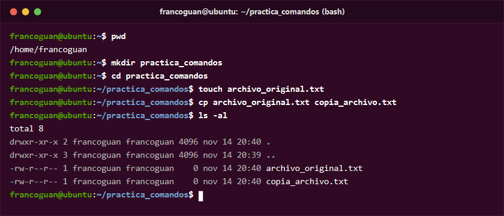
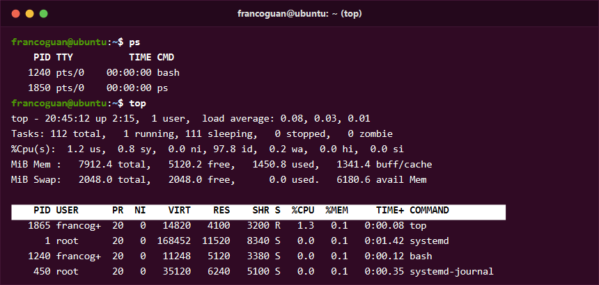
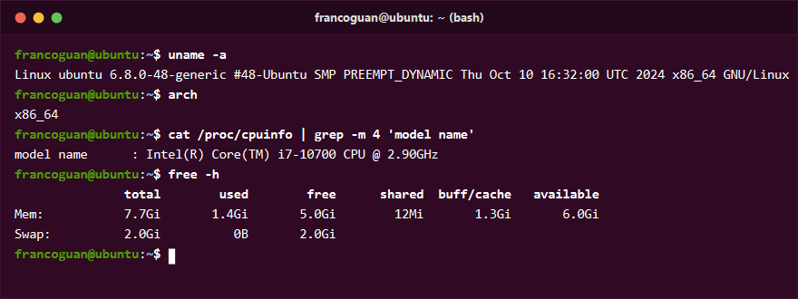
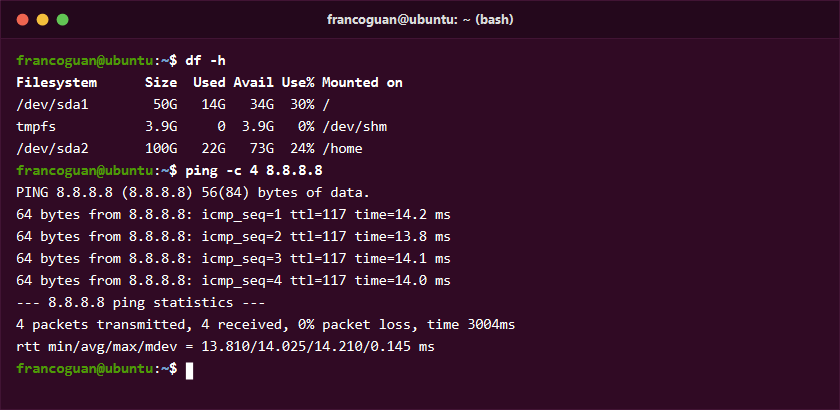

# TP: Comandos Básicos, Procesos y Utilidades en Linux

* **Materia:** Mantenimiento de Software
* **Estudiante:** Franco Guantay
* **Profesor:** Artaza
* **Fecha de Entrega:** 2026

---

## 1. Gestión de Archivos y Directorios

* **Explicación de `ls -al`:**  
El comando `ls` simple únicamente muestra los nombres de los archivos y carpetas visibles en el directorio actual, sin aportar mayores detalles técnicos. En cambio, al utilizar la combinación de opciones `-al`:
  * La opción `-a` (*all*) muestra **todos** los elementos, incluyendo los archivos y directorios ocultos (aquellos cuyos nombres comienzan con un punto, como `.` que hace referencia al directorio actual y `..` al directorio padre superior).
  * La opción `-l` (*long*) presenta el listado en formato largo y detallado, exponiendo para cada archivo: su tipo y permisos (`drwxr-xr-x` o `-rw-r--r--`), cantidad de enlaces, usuario propietario (`francoguan`), grupo propietario (`francoguan`), tamaño en bytes, fecha y hora de última modificación, y finalmente el nombre del archivo.

---

## 2. Monitoreo de Procesos

* **Diferencia entre `ps` y `top`:**  
El comando `ps` (Process Status) toma una instantánea estática del estado de los procesos en el momento exacto en que es invocado y finaliza inmediatamente su ejecución; sin opciones adicionales, únicamente informa los procesos vinculados a la terminal actual del usuario. Por el contrario, `top` es un monitor interactivo en tiempo real que permanece en pantalla y refresca continuamente (por defecto cada 3 segundos) el uso de procesador, memoria RAM y el listado de todos los procesos del sistema ordenados según el consumo de recursos, permitiendo interactuar con ellos en vivo.

* **Uso de `kill`:**  
El comando `kill pid` (donde *pid* representa el identificador numérico del proceso, *Process ID*) se utiliza para enviar señales a un proceso específico. En el caso de que un programa se quede colgado, congelado o sin responder, `kill` permite solicitarle su terminación limpia (mediante la señal por defecto `SIGTERM` / 15) o forzar su cierre inmediato y definitivo a nivel de kernel (usando `kill -9 pid` con `SIGKILL`), liberando de inmediato la memoria y los ciclos de CPU sin necesidad de reiniciar el equipo ni cerrar la sesión.

---

## 3. Información del Sistema

* **Detalles del Kernel y Memoria:**  
  * **Comando `uname -a`:** Aporta información integral y detallada sobre el núcleo del sistema operativo. Muestra el nombre del kernel (`Linux`), el nombre de red de la máquina (`ubuntu`), la versión y revisión exacta del kernel instalado (`6.8.0-48-generic`), fecha y hora en la que fue compilado, la arquitectura de la CPU (`x86_64`) y la distribución del sistema (`GNU/Linux`).
  * **Comando `free`:** Expone el estado del uso de la memoria en el equipo. Muestra la memoria física RAM total, cuánta memoria se encuentra en uso activo (*used*), cuánta está completamente libre (*free*), la memoria compartida (*shared*), la utilizada para buffers y caché de disco (*buff/cache*), y la memoria efectivamente disponible para nuevas aplicaciones (*available*), además del estado y utilización del espacio de intercambio (*swap*).

---

## 4. Red y Espacio en Disco

* **Funcionamiento de `ping`:**  
El objetivo principal de utilizar el comando `ping` en una red TCP/IP es diagnosticar y verificar la **conectividad y el tiempo de respuesta (latencia)** entre nuestro equipo y otro host remoto (o servidor en internet, como la dirección IP `8.8.8.8` de Google). Funciona enviando paquetes de solicitud de eco mediante el protocolo **ICMP** (*Echo Request*) y esperando la respuesta del destinatario (*Echo Reply*). Permite confirmar si la máquina destino está alcanzable en la red, medir el tiempo en milisegundos que tarda la comunicación de ida y vuelta (RTT) y constatar si existe pérdida de paquetes en el trayecto.
