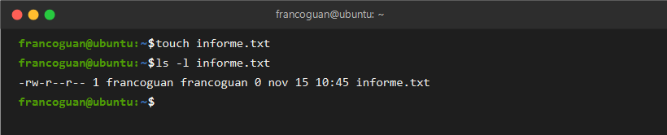
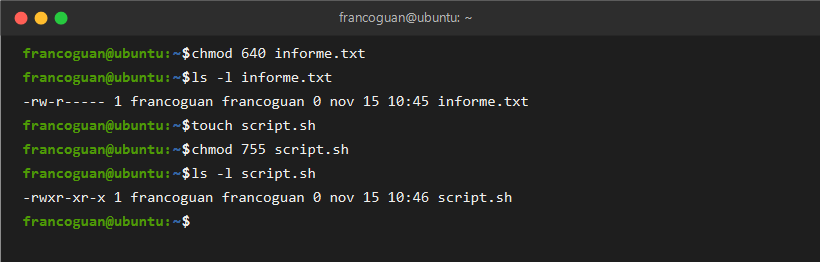
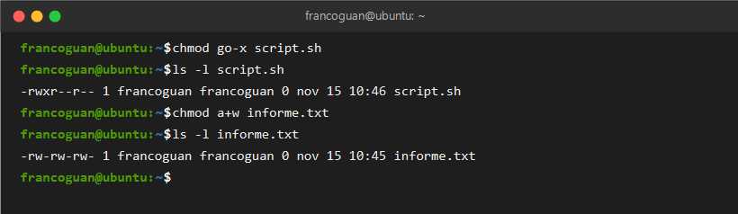
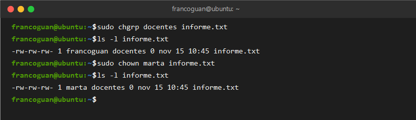
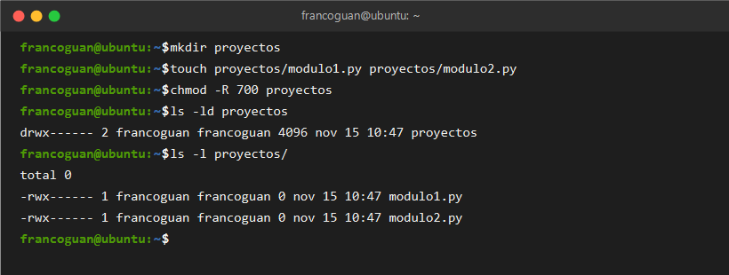

# TP: Permisos de Archivos, Directorios y Propiedad en Linux

* **Materia:** Mantenimiento de Software
* **Estudiante:** Franco Guantay
* **Profesor:** Artaza
* **Fecha de Entrega:** 2026

---

## 1. Lectura e Interpretación de Permisos (`ls -l`)

En Linux, los archivos y directorios definen permisos para tres niveles: propietario (*user*), grupo (*group*) y otros (*others*).

### Comandos ejecutados:
```bash
touch informe.txt
ls -l informe.txt
```

### Evidencia:


### Desglose y estructura de permisos:
| Posición | Representación | Significado / Permiso |
| :--- | :--- | :--- |
| **Tipo de archivo** (1º carácter) | `-` / `d` / `l` | Identifica la naturaleza del elemento en el sistema de archivos: `-` para archivo regular/ordinario, `d` para directorio, y `l` para enlace simbólico (*symbolic link*). |
| **Propietario (`u`)** (caracteres 2 a 4) | `rwx` o `-` | Permisos asignados al usuario dueño del archivo. `r` (lectura), `w` (escritura) y `x` (ejecución). En la captura se observa `rw-` (lectura y escritura, sin ejecución). |
| **Grupo (`g`)** (caracteres 5 a 7) | `rwx` o `-` | Permisos concedidos a los integrantes del grupo al que pertenece el archivo. En la captura se observa `r--` (únicamente lectura). |
| **Otros (`o`)** (caracteres 8 a 10) | `rwx` o `-` | Permisos para el resto de los usuarios del sistema (*world/others*). En la captura se observa `r--` (únicamente lectura). |

* **Significado de las letras de permisos:**
  * **`r` (*read*):** Permite leer y abrir el contenido de un archivo (o listar el contenido si es un directorio).
  * **`w` (*write*):** Permite modificar, editar, truncar o sobrescribir el archivo (o crear y eliminar elementos dentro si es un directorio).
  * **`x` (*execute*):** Permite ejecutar el archivo como programa o script (o ingresar y atravesarlo mediante `cd` si es un directorio).

---

## 2. Permisos en Modo Octal

El formato octal asigna valores numéricos fijos a cada bit de permiso: Lectura ($r = 4$), Escritura ($w = 2$) y Ejecución ($x = 1$).

### Comandos ejecutados:
```bash
# 1. Asignar permisos 640 al archivo informe.txt
chmod 640 informe.txt
ls -l informe.txt

# 2. Crear script de prueba y asignar permisos 755
touch script.sh
chmod 755 script.sh
ls -l script.sh
```

### Evidencia:


### Cálculo matemático y desglose:
* **Desglose numérico 640:**
  * Propietario (`u`): $r(4) + w(2) = 6$
  * Grupo (`g`): $r(4) = 4$
  * Otros (`o`): $- = 0$
  * *Resultado:* `-rw-r-----` (lectura y escritura para el dueño, lectura para el grupo, sin acceso para otros).
* **Desglose numérico 755:**
  * Propietario (`u`): $r(4) + w(2) + x(1) = 7$
  * Grupo (`g`): $r(4) + x(1) = 5$
  * Otros (`o`): $r(4) + x(1) = 5$
  * *Resultado:* `-rwxr-xr-x` (control total de lectura, escritura y ejecución para el dueño; lectura y ejecución para grupo y otros).

---

## 3. Modo Simbólico

El modo simbólico utiliza identificadores de usuario (`u`, `g`, `o`, `a`) y operadores de acción (`+`, `-`, `=`) para realizar ajustes específicos sin sobreescribir los demás permisos.

### Comandos ejecutados:
```bash
# 1. Quitar el permiso de ejecución al grupo y a otros en script.sh
chmod go-x script.sh
ls -l script.sh

# 2. Agregar permiso de escritura a todos (all) en informe.txt
chmod a+w informe.txt
ls -l informe.txt
```

### Evidencia:


* **Ventaja del modo simbólico:**  
La gran ventaja práctica de la notación simbólica frente a la notación octal es su **capacidad de modificación granular e incremental**. En el modo octal es obligatorio calcular y especificar los permisos completos de los tres niveles simultáneamente, lo cual requiere conocer el estado anterior y arriesga alterar accidentalmente permisos existentes. Por el contrario, la notación simbólica permite añadir o retirar un atributo específico (como `go-x` o `a+w`) operando únicamente sobre los bits indicados, preservando inalterados todos los demás permisos.

---

## 4. Cambio de Propietario y Grupo

La propiedad y la pertenencia a grupo determinan qué conjunto de permisos se aplicarán al usuario en sesión.

### Comandos ejecutados:
```bash
# 1. Cambiar el grupo del archivo a docentes
sudo chgrp docentes informe.txt
ls -l informe.txt

# 2. Cambiar el propietario del archivo a marta
sudo chown marta informe.txt
ls -l informe.txt
```

### Evidencia:


* **¿Por qué se requiere privilegio superusuario para `chown`?:**  
En sistemas Linux y estándares POSIX, el cambio de propietario (*chown*) está restringido con exclusividad al superusuario `root` (mediante `sudo`) por razones críticas de **seguridad y cuotas de disco**:
  1. **Control de cuotas (*Disk Quotas*):** Si cualquier usuario pudiera transferir la propiedad de sus archivos, podría transferir archivos de gran tamaño a la cuenta de otro usuario para eludir sus propios límites de almacenamiento en disco.
  2. **Prevención de vulnerabilidades y suplantación:** Evita que un usuario cree archivos maliciosos (por ejemplo ejecutables con bits especiales o trampas de seguridad) y se los atribuya a otro usuario o servicio del sistema para eludir auditorías o escalar privilegios.
  3. **Irreversibilidad:** Si un usuario cediera la propiedad de su archivo, perdería automáticamente los derechos administrativos sobre él y no podría revertir la acción por sí mismo.

---

## 5. Permisos Recursivos en Directorios

Cuando se modifica una estructura de directorios, la opción recursiva `-R` propaga los permisos a la carpeta raíz, sus subdirectorios y todos los archivos contenidos.

### Comandos ejecutados:
```bash
# 1. Crear directorio con archivos dentro
mkdir proyectos
touch proyectos/modulo1.py proyectos/modulo2.py

# 2. Aplicar permisos 700 de forma recursiva
chmod -R 700 proyectos
ls -ld proyectos
ls -l proyectos/
```

### Evidencia:


* **Importancia del permiso `x` en un directorio:**  
En los directorios, el permiso de ejecución (`x` - *traverse/search*) no significa ejecutar un programa, sino que **otorga la facultad de entrar, atravesar e inspeccionar los inodos del directorio** (permite hacer `cd` hacia él y acceder a los archivos alojados adentro).  
Si a un directorio se le revoca el permiso `x`:
  * El usuario no podrá ingresar a él mediante el comando `cd` (recibirá un error de `Permission denied`).
  * Aunque el directorio tenga permiso de lectura `r`, si el usuario ejecuta `ls -l` únicamente podrá ver los nombres de los archivos pero verá signos de interrogación (`?`) en permisos, tamaños, propietarios y fechas porque el sistema no puede acceder a sus metadatos.
  * Tampoco se podrá leer, modificar ni ejecutar ningún archivo ubicado dentro de ese directorio, incluso si los archivos individuales disponen de permisos `777`.
