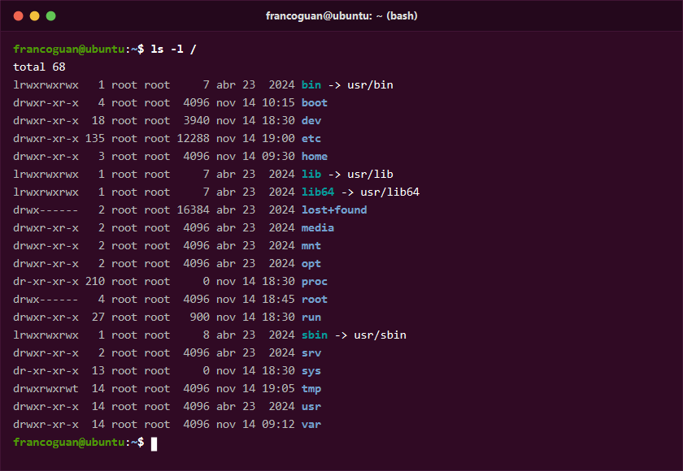
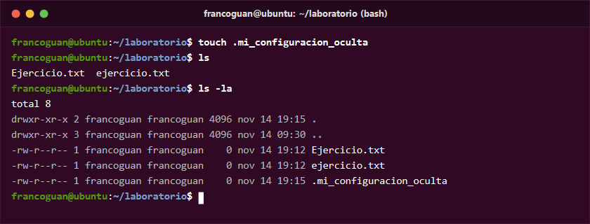
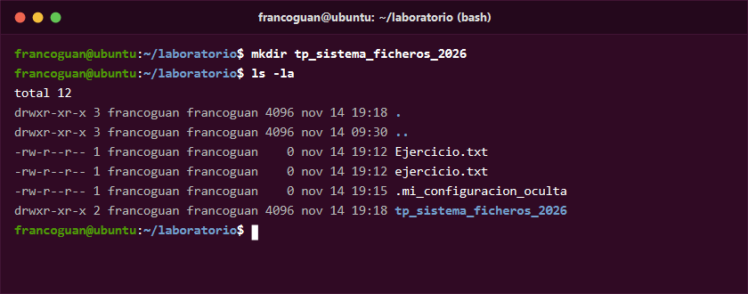
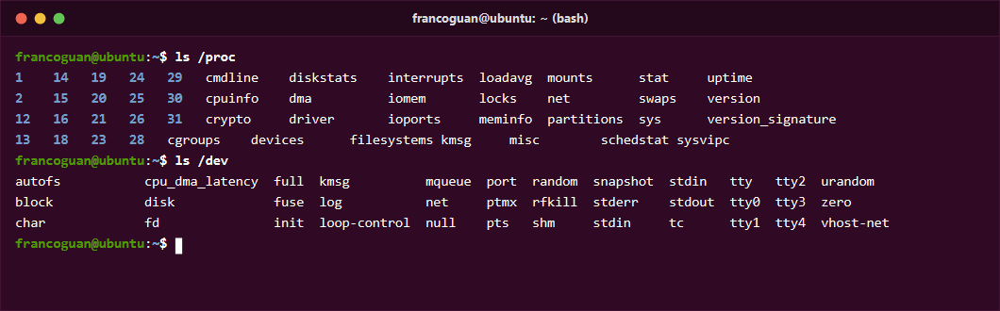

# TP: Sistema de Archivos en Linux

* **Materia:** Mantenimiento de Software
* **Estudiante:** Franco Guantay
* **Fecha de Entrega:** 2026
* **Profesor:** Artaza

---

## 1. Estructura del Árbol de Directorios

| Directorio | Función según la guía |
| :--- | :--- |
| `/etc` | Contiene los archivos de configuración de la mayoría de los programas y del sistema operativo. |
| `/home` | Contiene los archivos personales de los usuarios (documentos, descargas, carpetas propias). |
| `/dev` | Contiene archivos especiales o simbólicos que representan dispositivos de hardware (discos, puertos, terminales). |
| `/var` | Datos variables generados dinámicamente como archivos de log (registro de actividad) y bases de datos. |

---

## 2. Sensibilidad a Mayúsculas y Minúsculas (Case Sensitivity)

*Respuesta:*  
En Linux y sistemas UNIX, el sistema de archivos es **case-sensitive** (distingue estrictamente entre mayúsculas y minúsculas). Esto significa que cada nombre se almacena como una secuencia exacta de bytes según su código de caracteres (la 'E' mayúscula y la 'e' minúscula son caracteres distintos); por ende, `Ejercicio.txt` y `ejercicio.txt` son considerados archivos totalmente diferentes y conviven en el mismo directorio con inodos independientes.

En cambio, en Windows (con sistemas de archivos como NTFS o FAT32 bajo una interfaz insensible a mayúsculas y minúsculas, *case-insensitive*), ambos nombres apuntan a una misma referencia y el sistema operativo no permite crear o mantener dos archivos con el mismo nombre y diferente combinación de mayúsculas en una misma carpeta para prevenir colisiones o confusiones.

---

## 3. Visualización y Gestión de Archivos Ocultos

*Respuesta:*  
La utilidad de los archivos y carpetas ocultos (cuyo nombre comienza con un punto `.`, denominados *dotfiles*) es almacenar información de inicialización, preferencias personales del usuario y configuraciones propias de programas o del sistema operativo (como `.bashrc`, `.profile` o carpetas como `.config`).

De esta manera, el espacio de trabajo permanece limpio y despejado a la hora de listar directorios con comandos básicos como `ls`, protegiendo además estos archivos críticos de modificaciones o eliminaciones accidentales en el uso diario.

---

## 4. Buenas Prácticas en Nombres de Archivos

*Respuesta:*  
* **`tp_sistema_ficheros_2026` cumple con las recomendaciones** porque utiliza exclusivamente caracteres recomendados: letras en minúscula (`a-z`), números (`0-9`) y guiones bajos (`_`) en reemplazo de espacios en blanco. No utiliza caracteres especiales, signos de puntuación extraños ni acentos, lo que permite interactuar con la carpeta en la terminal sin comillas ni barras de escape.
* **`TP Sistema de Ficheros (Año 2026)!.doc` no cumple** debido a las siguientes malas prácticas detalladas en la guía:
  1. **Espacios en blanco:** La terminal de Linux utiliza los espacios para separar comandos y parámetros. Si no se entrecomilla, la shell interpretará cada palabra como un archivo diferente arrojando errores.
  2. **Caracteres especiales y de puntuación:** Emplea paréntesis `(` `)` y el signo de exclamación `!`, los cuales son interpretados por shells de Linux como caracteres de control (el signo `!` invoca el historial de comandos, generando el error `event not found`).
  3. **Letra "ñ" y acentos:** No son recomendados en sistemas UNIX/Linux debido a discrepancias históricas y problemas de codificación (*encoding* entre UTF-8 y Latin-1).
  4. **Extensión innecesaria y mayúsculas mezcladas:** Asigna una extensión `.doc` a un directorio, lo cual desorienta sobre el tipo de recurso que es.

---

## 5. Exploración de Dispositivos y Procesos

*Respuesta:*  
El directorio `/proc` es un sistema de archivos virtual (pseudo-filesystem *procfs*) generado dinámicamente en memoria RAM por el kernel de Linux (no ocupa espacio en el disco físico).

Su función es almacenar **información temporal y en tiempo real sobre los procesos en ejecución** (carpetas nombradas con su PID como `/proc/1`), así como el estado interno del kernel y las métricas de hardware del sistema (`/proc/cpuinfo`, `/proc/meminfo`, `/proc/uptime`, etc.).
