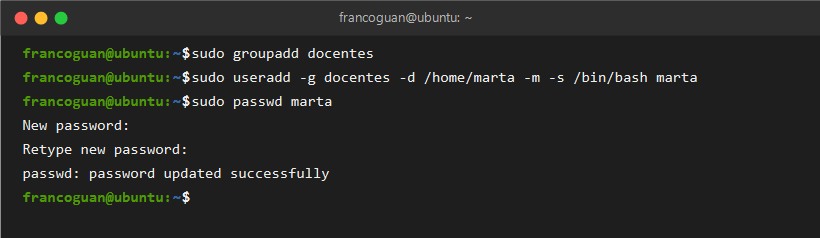
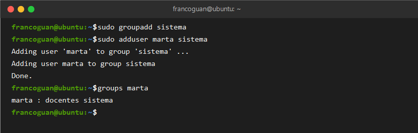
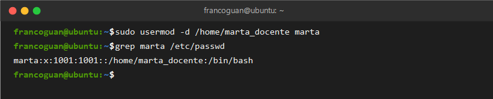
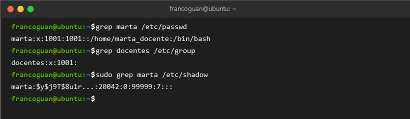
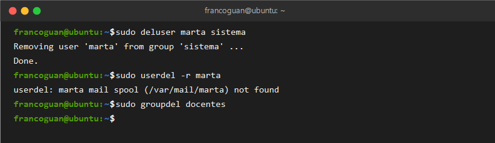

# TP: Administración de Usuarios y Grupos en Linux

* **Materia:** Mantenimiento de Software
* **Estudiante:** Franco Guantay
* **Profesor:** Artaza
* **Fecha de Entrega:** 2026

---

## 1. Creación de Grupos y Usuarios

La administración de usuarios y grupos solamente puede realizarla el usuario root o un usuario con permisos privilegiados mediante `sudo`.

### Comandos ejecutados:
```bash
# 1. Crear un grupo primario denominado docentes
sudo groupadd docentes

# 2. Crear un usuario llamado marta con grupo docentes, home /home/marta y shell /bin/bash
sudo useradd -g docentes -d /home/marta -m -s /bin/bash marta

# 3. Establecer contraseña para la usuaria marta
sudo passwd marta
```

### Evidencia:


* **Explicación del parámetro `-m`:**  
La función principal de la opción `-m` (*make home*) en el comando `useradd` es forzar la **creación automática del directorio personal** del usuario (en este caso `/home/marta`) en el sistema de archivos y copiar dentro de él los archivos plantilla de configuración inicial del entorno shell desde el directorio `/etc/skel` (como `.bashrc`, `.profile` y `.bash_logout`).  
Si se omite el parámetro `-m`, el sistema creará la cuenta y registrará la ruta teórica del home en `/etc/passwd`, pero **la carpeta física no se creará en el disco**. En consecuencia, cuando la usuaria intente iniciar sesión, el sistema emitirá una advertencia (`No directory, logging in with HOME=/`), iniciará la sesión posicionándose en la raíz del sistema (`/`) y carecerá de los archivos de configuración y permisos requeridos para un entorno de trabajo normal.

---

## 2. Gestión de Grupos Secundarios

En Linux, un usuario puede pertenecer a múltiples grupos además de su grupo primario, lo cual facilita la concesión y administración de permisos por roles.

### Comandos ejecutados:
```bash
# 1. Crear un grupo secundario llamado sistema
sudo groupadd sistema

# 2. Añadir a la usuaria marta al grupo secundario sistema
sudo adduser marta sistema

# 3. Verificar los grupos a los que pertenece la usuaria
groups marta
```

### Evidencia:


* **Comando para quitar usuario de un grupo:**  
Para retirar a un usuario de un grupo secundario sin afectar a sus demás pertenencias, se pueden emplear los siguientes comandos:
  * En distribuciones Debian/Ubuntu:
    ```bash
    sudo deluser marta sistema
    ```
  * Comando estándar universal en cualquier distribución GNU/Linux:
    ```bash
    sudo gpasswd -d marta sistema
    ```

---

## 3. Modificación de Parámetros de Usuario

El comando `usermod` permite cambiar configuraciones preexistentes de una cuenta de usuario sin necesidad de eliminarla ni perder sus datos.

### Comandos ejecutados:
```bash
# Modificar el directorio personal (home) de la usuaria marta a una nueva ruta
sudo usermod -d /home/marta_docente marta

# Verificar el cambio en el fichero de cuentas
grep marta /etc/passwd
```

### Evidencia:


* **Diferencia entre `useradd` y `usermod`:**  
  * **`useradd`**: Es una herramienta de bajo nivel que se utiliza exclusivamente para **dar de alta y crear nuevos usuarios** en el sistema desde cero, registrando sus valores por primera vez en `/etc/passwd`, `/etc/shadow` y `/etc/group`.
  * **`usermod`**: Es una herramienta administrativa orientada al **mantenimiento y modificación de usuarios preexistentes**. No crea cuentas nuevas, sino que altera propiedades ya configuradas (como cambiar el directorio home, cambiar el nombre de usuario, modificar o añadir grupos, cambiar la shell por defecto, o bloquear/desbloquear una cuenta).

---

## 4. Ficheros de Configuración

Toda la información del sistema respecto a usuarios, grupos y contraseñas se almacena de forma estructurada en archivos del directorio `/etc`.

### Comandos ejecutados:
```bash
# Consultar la línea del usuario marta en el archivo de cuentas del sistema
grep marta /etc/passwd

# Consultar la información del grupo docentes en el archivo de grupos
grep docentes /etc/group

# Consultar el registro seguro de la contraseña cifrada
sudo grep marta /etc/shadow
```

### Evidencia:


| Fichero | Contenido / Función |
| :--- | :--- |
| `/etc/passwd` | Almacena la información principal de las cuentas de usuario del sistema (legible por todos los usuarios). Contiene 7 campos por línea: nombre de usuario, indicador de contraseña (`x`), UID numérico, GID numérico del grupo primario, datos de usuario o comentario (GECOS), ruta absoluta al directorio personal (*home*), y la shell predeterminada (`/bin/bash`). |
| `/etc/group` | Define los grupos existentes en el sistema operativo y su membresía (legible por todos los usuarios). Contiene 4 campos: nombre del grupo, indicador de clave (`x`), GID numérico, y la lista de nombres de usuarios que pertenecen a él como grupo secundario. |
| `/etc/shadow` | Archivo de máxima seguridad accesible únicamente por el superusuario `root`. Almacena las contraseñas reales de los usuarios cifradas con algoritmos de hashing seguro (como SHA-512 o yescrypt), junto con las directivas de caducidad y envejecimiento de credenciales (fecha del último cambio, período mínimo/máximo de validez y días de advertencia de expiración). |

---

## 5. Eliminación de Cuentas y Grupos

Es importante limpiar las cuentas en desuso garantizando la eliminación o conservación adecuada de los datos según las políticas de seguridad.

### Comandos ejecutados:
```bash
# 1. Quitar a la usuaria marta del grupo sistema
sudo deluser marta sistema

# 2. Eliminar al usuario marta junto con su directorio home de forma recursiva
sudo userdel -r marta

# 3. Eliminar el grupo docentes
sudo groupdel docentes
```

### Evidencia:


* **Uso del parámetro `-r` en `userdel`:**  
El parámetro `-r` (*remove*) indica al comando `userdel` que, además de borrar las entradas correspondientes del usuario en `/etc/passwd` y `/etc/shadow`, proceda a **eliminar físicamente y de forma recursiva su directorio personal (*home*) y su buzón de correo (*mail spool*)**. Si se omitiera el parámetro `-r`, el usuario sería borrado del sistema pero sus archivos quedarían en el disco como elementos huérfanos asociados a un UID que ya no existe.

* **Condición para borrar un grupo con `groupdel`:**  
Para que el comando `groupdel` permita eliminar un grupo con éxito, es requisito obligatorio que dicho grupo **no sea el grupo primario de ningún usuario existente** en el sistema. En caso de que exista al menos un usuario registrado con ese GID como grupo principal, el comando abortará la operación devolviendo el error `cannot remove the primary group of user`. Para poder eliminarlo, primero se debe reasignar el grupo primario de los usuarios vinculados o borrar previamente a dichos usuarios.
